# تکمیل فصل‌های ۱۰ تا ۱۵ علوم‌یار هفتم - ۲۱ اکتبر ۲۰۲۶

نسخهٔ ۰٫۹ شامل صورت و پاسخ بومیِ هر ۳۱۷ سؤال فصل‌های ۱ تا ۱۵ است. ۱۱۴ سؤال فصل‌های ۱۰ تا ۱۵ بازبینی شد و ۸۵ سؤالِ فصل‌های ۱۱ تا ۱۵ در این مرحله تبدیل شد. همهٔ ۳۳۴ بخش تمرینی، دو راهنمای مستقل دارند؛ در مجموع ۶۶۸ راهنما. متن اصلی، شماره‌ها، کلیدها، چهار فیلد مرجعِ هر سؤال و ۱۶ PDF اصلیِ ویرایش ۱۴۰۵ حفظ شده‌اند.

## محتوا و تعامل

| فصل | تعداد سؤال | نتیجه |
|---|---:|---|
| ۱۰ | ۲۹ | بازبینی راهنماها، گزینه‌های مفهومی و تفاوت معیار علمی با موارد مسئله‌دارِ کلید چاپی |
| ۱۱ | ۱۳ | یاخته، اجزای یاخته، بافت و جاندار؛ شکل مستقل، تطبیق اجزا و انتخاب در متن |
| ۱۲ | ۲۰ | مواد مغذی، نیاز غذایی و ویتامین‌ها؛ طبقه‌بندی، چندانتخابی و خواندن نمودار |
| ۱۳ | ۱۷ | گوارش و دندان‌ها؛ شکل پیش از کنترل‌ها، پاسخ‌های چندقسمتی و تمرین علمی جدا برای تست مسئله‌دار |
| ۱۴ | ۱۵ | قلب، گردش خون، رگ‌ها و خون؛ تکمیل مسیر با جهت اصلی، جدول مقایسه و تطبیق |
| ۱۵ | ۲۰ | تنفس و دفع؛ اجزای شکل، تبادل گاز و مسیرهای بدن با انتخاب‌های مستقل |

گزینه‌های تمرین با توجه به صورت سؤال نوشته شده‌اند تا به تکه‌های مبهم پاسخنامه متکی نباشند. تمام بانک‌ها، از جمله صحیح/غلط، پس از انتخاب برای خانه‌های دیگر هم در دسترس می‌مانند. جدول‌ها کامل و بدون پیمایش افقی‌اند. راهنماها رابطهٔ علمی و روش فکرکردن را توضیح می‌دهند و فهرست نهایی پاسخ‌ها را تحویل نمی‌دهند. بخش درست پس از بررسی قفل می‌شود؛ بخش نادرست قابل اصلاح است. بررسی کل سؤال و رفتن به سؤال بعدی صریح‌اند.

۱۲ شکل سؤالِ ارسالی فصل‌های ۱۱ تا ۱۵ با تبدیل WebP بدون اتلاف متصل شد؛ اکنون ۵۲ شکل سؤال و هفت تصویر آموزشی پاسخ از بستهٔ ارسالی فعال‌اند. دو شکل اصلی دیگر مستقیماً از تصویر تعبیه‌شدهٔ PDF استخراج شد. چهار صفحهٔ شکلِ یاخته، نمودار غذایی، قلب و دستگاه تنفس از ناحیهٔ مستقل منبع ساخته شد تا نوشته‌ها و جاخالی‌های سؤال مجاور وارد شکل نشوند؛ شماره‌ها و شش تصویر تعبیه‌شده پیکسل‌به‌پیکسل حفظ شده‌اند.

## یکسان بودن دو مسیر پاسخ

پس از حل کاملاً درست، یا پس از دو تلاش کامل نادرستِ متفاوت و هر دو راهنما، همان بخش «پاسخ کتاب‌کار» با درخواست صریح «دیدن پاسخ» نمایش داده می‌شود. دادهٔ این بخش تنها پاسخ مرجعِ سؤال است؛ انتخاب فعلی دانش‌آموز و مسیر بازشدن، محتوای آن را تغییر نمی‌دهند. تصویر آموزشی موجود نیز در همان بخش و با همان شرط می‌آید.

آزمون تازه هفت صفحهٔ واقعی سؤال را در هر دو مسیر باز کرده، نبود پاسخ پیش از درخواست و برابری تمام متن‌ها، سلول‌های جدول، صورت و مخرج فرمول‌ها، شکل اصلیِ کلید و تصویر آموزشی را کنترل کرده است: فصل ۱ سؤال ۵، فصل ۲ سؤال ۹، فصل ۵ سؤال ۲، فصل ۱۰ سؤال ۱۳، فصل ۱۴ سؤال ۱۰، فصل ۱۵ سؤال ۸ و تست ۳ فصل ۱۳. نمایش کلیدِ هر ۳۱۷ سؤال نیز در آزمون سراسریِ چیدمان پوشش دارد.

## نکات علمی و مغایرت‌های چاپی

| مورد | رفتار تمرین و پاسخ مرجع |
|---|---|
| فصل ۱۱ سؤال ۳ | غشای یاخته و سیتوپلاسم وجه مشترک‌اند؛ استثنای نداشتن هسته در گلبول قرمز بالغ انسان توضیح داده شده است. عبارت چاپی در کلید باقی است. |
| فصل ۱۲ سؤال ۱ | طبقه‌بندی ویتامین‌ها حفظ و استثنای ذخیرهٔ B12 برای ادعای کلیِ ذخیره‌نشدن ذکر شده است. |
| فصل ۱۲ سؤال ۴ | تمرین مثال نان را هم در کنار سیب‌زمینی و خیارِ پوست‌گرفته پوشش می‌دهد؛ حذف آن در کلید گزارش شده است. |
| فصل ۱۲ سؤال ۸ | رابطهٔ نوع و مقدار چربی با سلامت توضیح داده شده و تعبیر نشستن مستقیمِ همان تکه چربی خوراکی در رگ به‌عنوان واقعیت آموزش داده نمی‌شود. |
| فصل ۱۲ سؤال ۱۰ | کمبود پروتئین پیامد قطعی گیاه‌خواری نیست؛ کفایت و تنوع منابع پروتئین معیار تمرین است. |
| فصل ۱۲ سؤال‌های ۱۱ و ۱۴ | نقش ویتامین D در جذب کلسیم از روده و سلامت استخوان روشن شده است. |
| فصل ۱۳ سؤال ۲ | مسیر اولیهٔ بیشتر چربی‌های جذب‌شده از لنف توضیح داده شده است؛ نام اندام مورد پرسش همان رودهٔ باریک است. |
| فصل ۱۳ سؤال ۳ | شکل پرنده ساده‌سازی شده است؛ داشتن بخش باریک و بزرگِ روده در تمرین لحاظ می‌شود. عبارت چاپی «یک روده» جدا حفظ شده است. |
| فصل ۱۳ تست ۳ | گزینه‌های اصلی و کلید چاپی «ج» بدون تغییر و با یادداشت بررسی مؤلف نمایش داده می‌شوند. تمرین علمیِ مستقلِ تطبیقِ کار دندان‌ها، ترتیب غلط چاپی را پاداش نمی‌دهد. انتخاب قدیمی نیز مجوز راهنما یا نمایش پاسخِ تمرین تازه نیست. |
| فصل ۱۴ سؤال ۴ | ردیف دوم مسیر مطابق شکل از چپ به راست است. چهار انتخابِ دو ردیف در یک پاسخ مشترک ذخیره می‌شوند. |
| فصل ۱۴ سؤال ۹ | پنج لیتر و نسبت ۵۵/۴۵، مقادیر تقریبیِ فرد بزرگسال معرفی شده‌اند. |
| فصل ۱۵ سؤال ۵ | اثر آلاینده‌ها به کاهش الزامی و عمدهٔ درصد اکسیژن هوا تعبیر نشده است. |
| فصل ۱۵ سؤال ۱۴ | ذخیرهٔ موقت طبیعی ادرار از تأخیر طولانیِ مکرر و تخلیهٔ ناقص تفکیک شده است. |

مهاجرت پاسخ‌های قدیمی، ادعای نادرستِ «همهٔ یاخته‌ها هسته دارند»، «گیاه‌خواری حتماً کمبود پروتئین می‌دهد» یا «پرنده فقط یک نوع روده دارد» را به پاسخ درستِ تمرین جدید تبدیل نمی‌کند. اصل پاسخنامه بازنویسی نشده است.

مراجع علمیِ بازبینی: [NLM، گلبول قرمز](https://meshb.nlm.nih.gov/record/ui?ui=D004912)، [NIH، ویتامین B12](https://ods.od.nih.gov/factsheets/VitaminB12-HealthProfessional/)، [NIH، ویتامین D](https://ods.od.nih.gov/factsheets/VitaminD-HealthProfessional/)، [WHO، تغذیه](https://www.who.int/news-room/fact-sheets/detail/healthy-diet)، [USDA، منابع پروتئین](https://www.myplate.gov/web/web/eat-healthy/protein-foods)، [NIDDK، گوارش](https://www.niddk.nih.gov/health-information/digestive-diseases/digestive-system-how-it-works)، [دانشگاه کنتاکی، گوارش پرندگان](https://publications.mgcafe.uky.edu/sites/publications.ca.uky.edu/files/ASC203.pdf)، [OpenStax، دهان و دندان](https://openstax.org/books/anatomy-and-physiology-2e/pages/23-3-the-mouth-pharynx-and-esophagus)، [EPA، آلاینده‌ها](https://www.epa.gov/criteria-air-pollutants)، [NIDDK، تخلیهٔ مثانه](https://www.niddk.nih.gov/health-information/urologic-diseases/urinary-retention/prevention).

## نتیجهٔ اجرای واقعی

[اجرای موفق اندروید](https://github.com/nranjbar/oloomyar7/actions/runs/39624080760) برای تعهد `09441896d203babc5649e7275337f0a883ad5ee4`:

- ساخت APK و AAB و هر ۴۱ آزمون واحد و ۵۹ آزمون رابط روی API 35 موفق؛ بدون حذف یا غیرفعال‌کردن آزمون.
- هر ۱۹۰۲ حالت نمایشِ صورت تکمیل‌شده و پاسخِ ۳۱۷ سؤال موفق: عرض ۳۲۰ و قلم ۱۰۰٪، عرض ۳۶۰ و قلم ۱۵۰٪، عرض ۳۲۰ و قلم ۲۰۰٪. کنترل منفیِ بریدگیِ واقعی اجرا شد.
- پیکسل‌های ۵۹ تصویر علمی ارسالی و ۱۹ تصویر استخراج‌شده از PDF روی اندروید کنترل شد. تمام 150 فایلِ asset در APK با منبع بازبینی‌شده برابر است.
- هر سه آزمون ارتقا از نسخهٔ ۰٫۸ و بازیابی پس از پایان واقعی فرایند موفق؛ پیشرفت، پیش‌نویس، راهنما، بذر ترتیب گزینه‌ها، موقعیت مطالعه، نشان و تنظیمات حفظ شدند.
- بارگیری تصویر در پس‌زمینه انجام می‌شود و انتشار نتیجه به رابط، صریحاً روی نخ اصلی است. آزمون جابه‌جایی سریع میان همهٔ سؤال‌ها و خروج از صفحه نیز موفق شد.

APK آزمایشی 66,416,055 بایت است و با کلید ثابت نسخه‌های بازبینی امضا شده است. این شواهد مربوط به دستگاه و اندازه‌های آزموده‌شده‌اند.

[رسید اجرا](../qa/grade7_v09_verification.json)، [گزارش حالت‌های نمایش](../qa/native_layout_audit_v09.json)، [برابری مسیرهای پاسخ](../qa/reference_route_parity_v09.json)، [بازبینی سؤال‌به‌سؤال فصل‌های ۱۰ تا ۱۵](../qa/chapters_10_15_practice_review.json)، [تطبیق منبع ۸۵ سؤال تازه](../qa/source/native-chapters-eleven-to-fifteen-manifest.json) و [منشأ شکل‌های مستقل](../qa/source/native-biology-diagrams.json) ثبت شده‌اند.

## تصاویر دستگاه

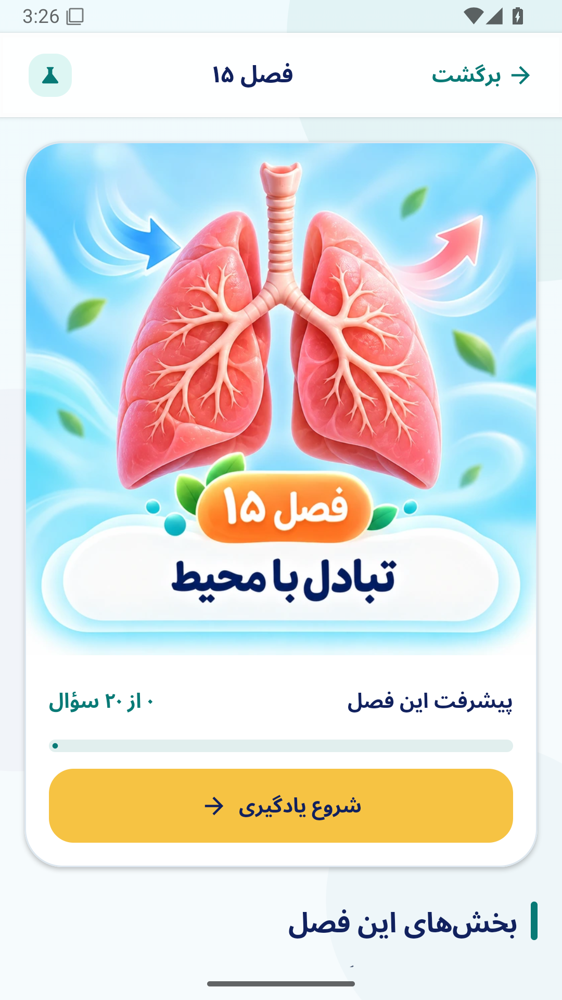

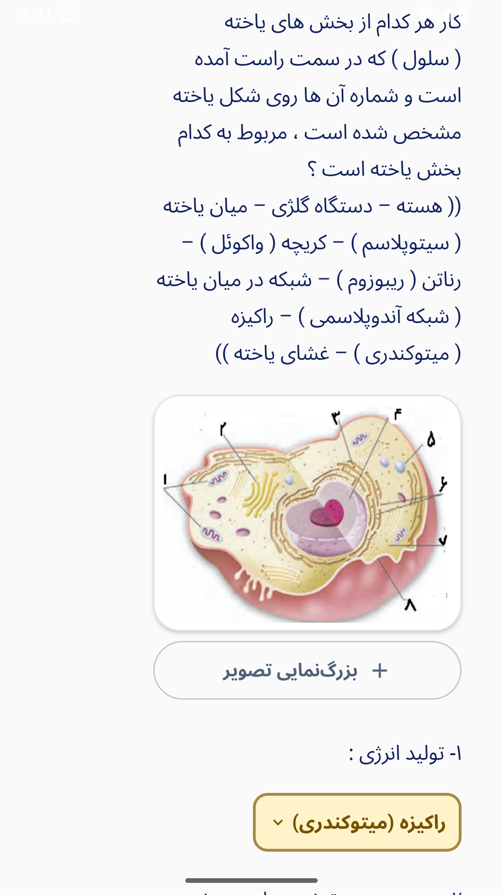

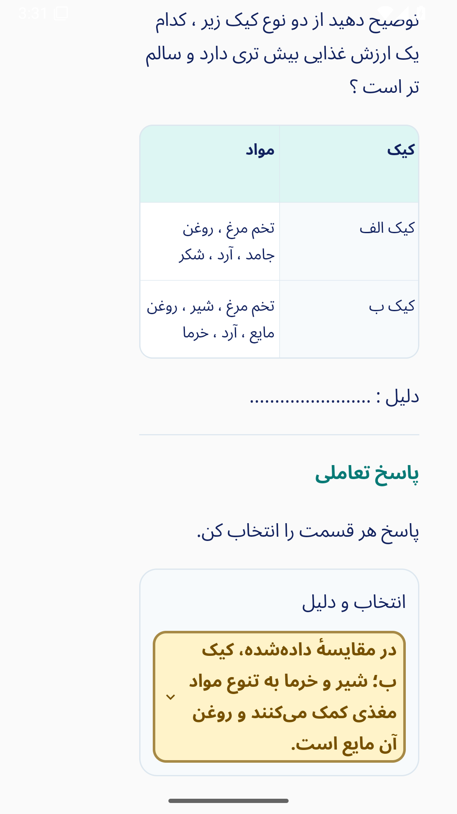

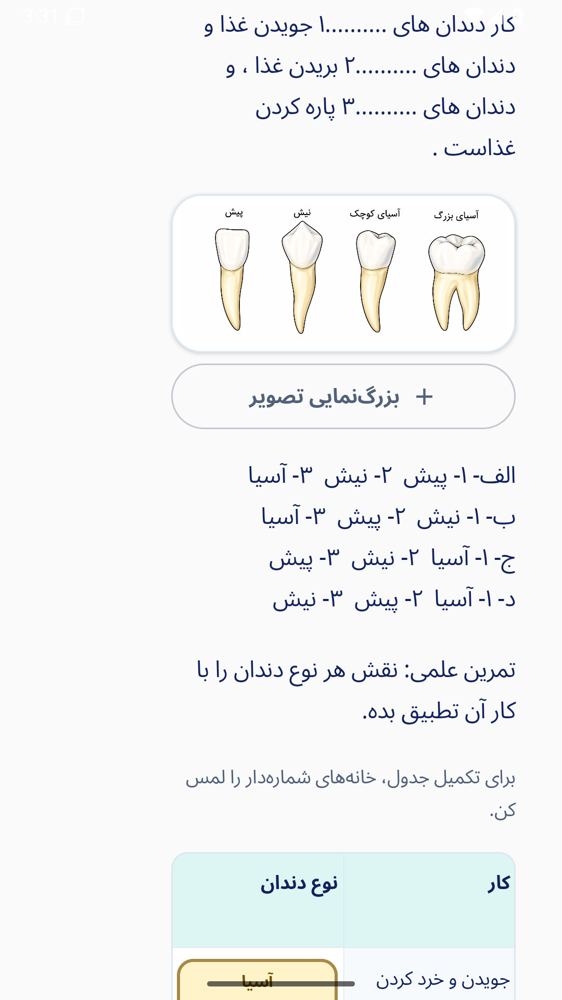

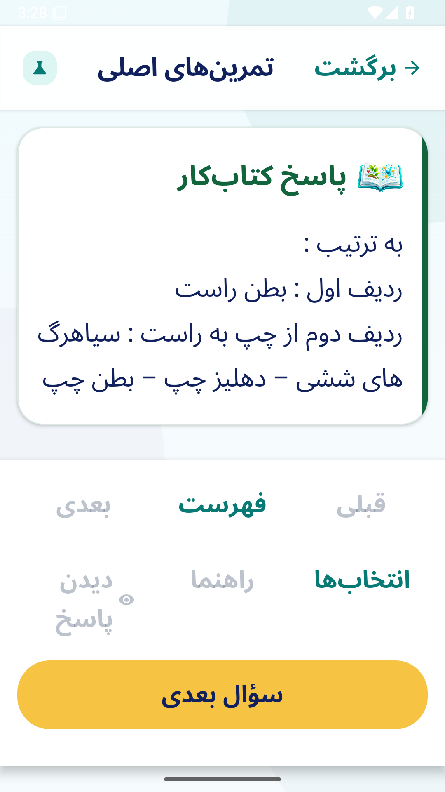

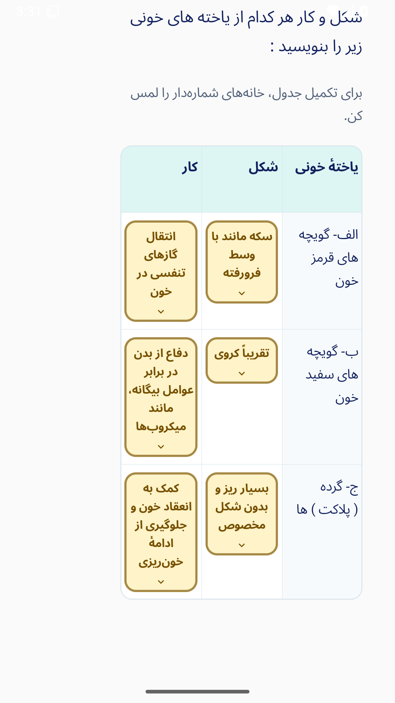

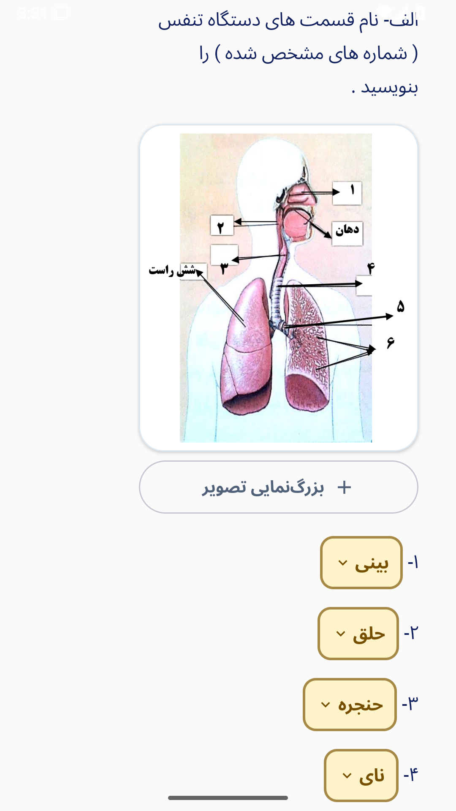

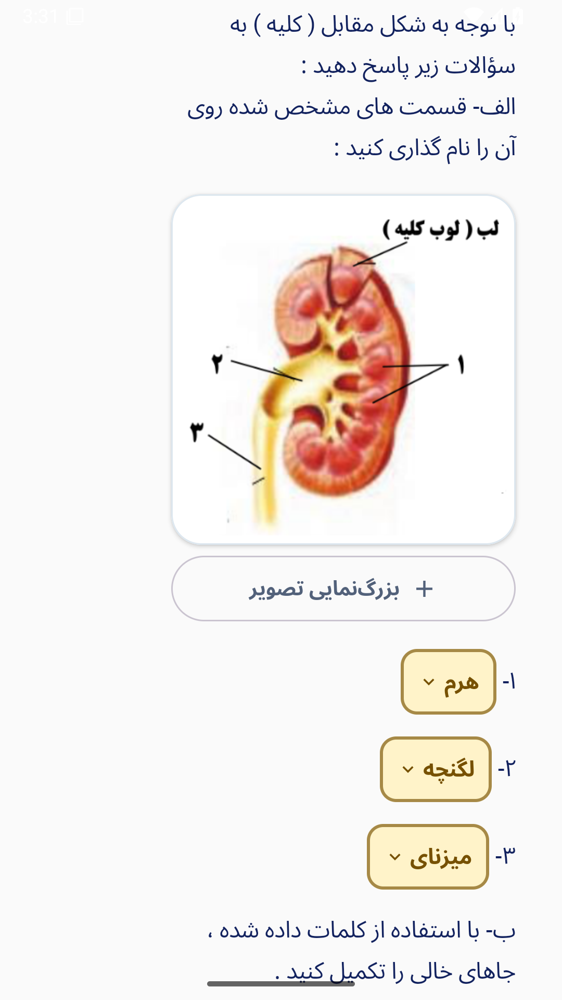

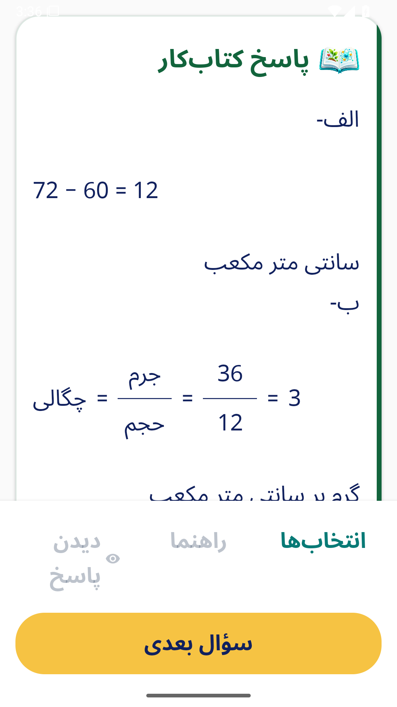

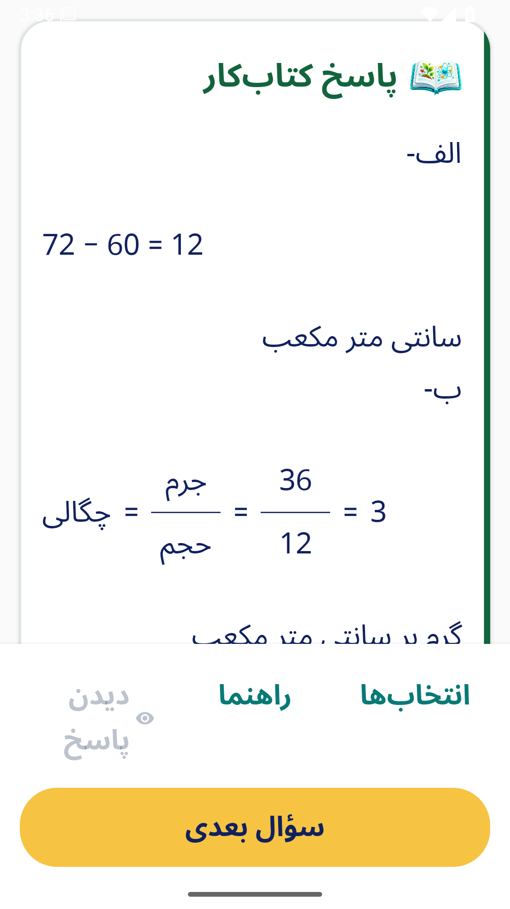

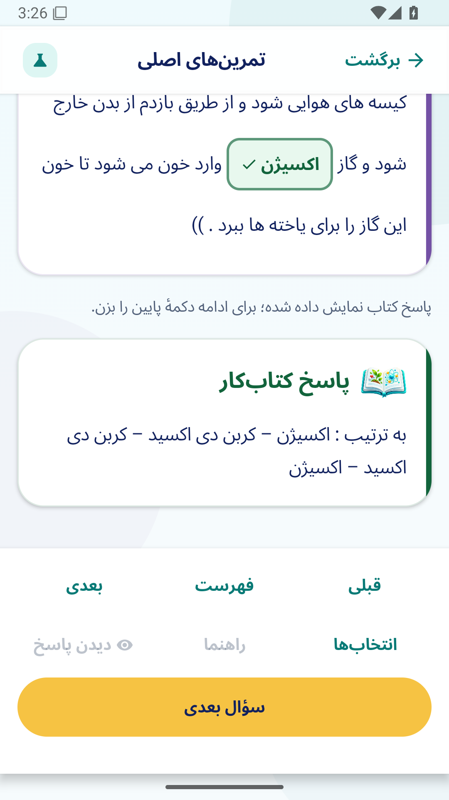

## ادامهٔ کار پس از دریافت تصاویر

تصاویر پاسخِ اولویت‌بالایی که مؤلف در حال آماده‌کردن آن‌هاست، پس از دریافت به همان بخش پاسخ مرجع افزوده می‌شوند. نمایش فصل‌ها به این فایل‌های آتی وابسته نیست و جای خالیِ تصویر ناموجود نشان داده نمی‌شود. فهرست قبلیِ تصاویر فصل‌های ۳ تا ۱۰ معتبر است. سؤالات پایانی صفحات ۶۰ تا ۶۳ مجموعه‌ای جدا از ۳۱۷ سؤالِ فصل‌ها هستند. برای نهایی‌کردن کلیدِ تست ۳ فصل ۱۳، نظر مؤلف همچنان لازم است.
