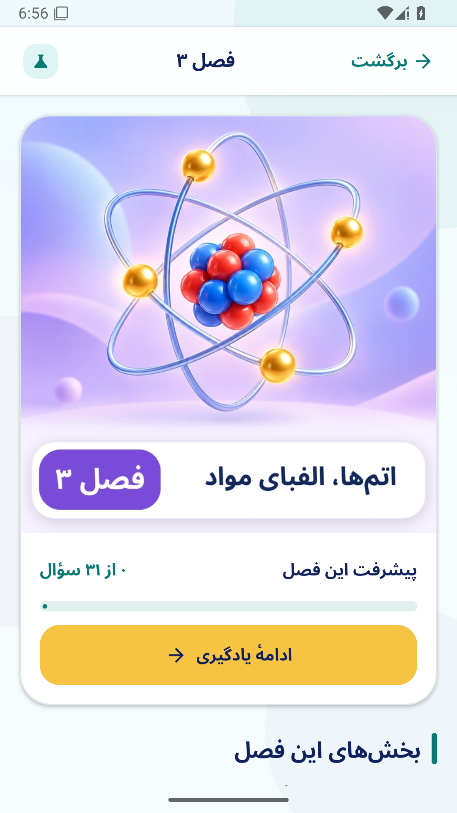
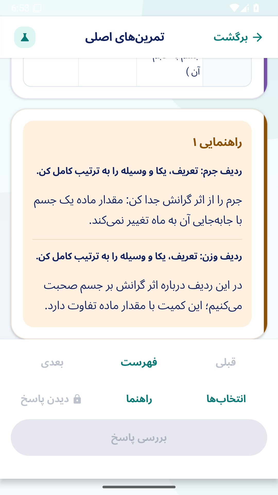
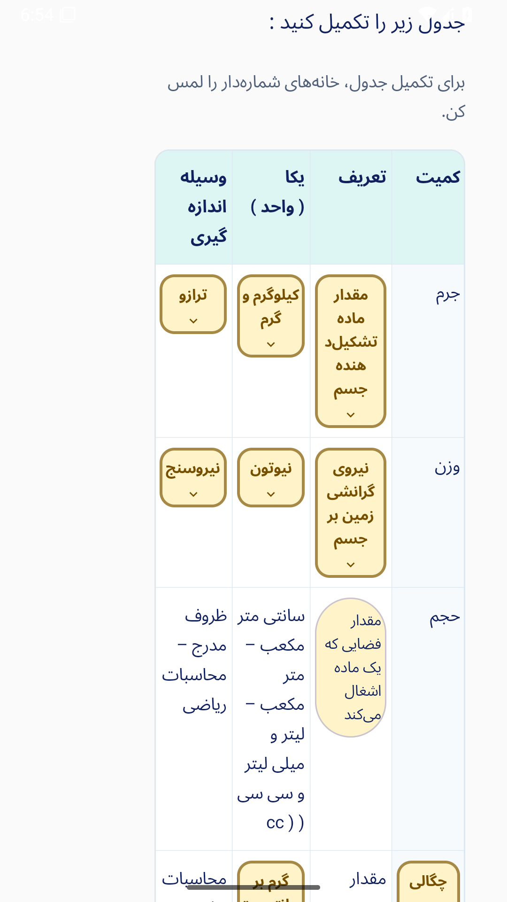
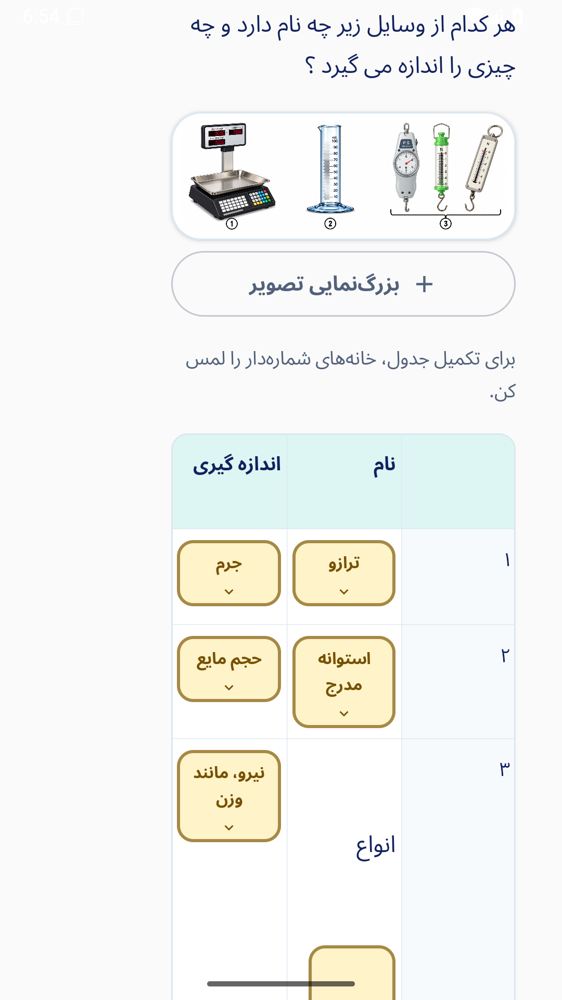
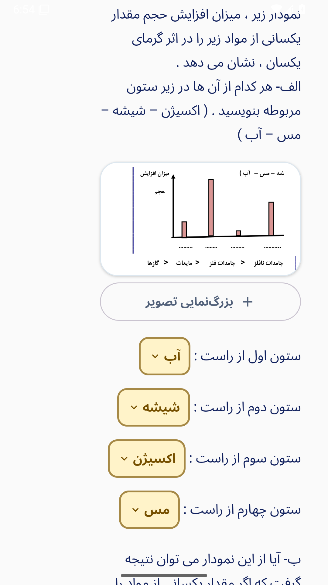
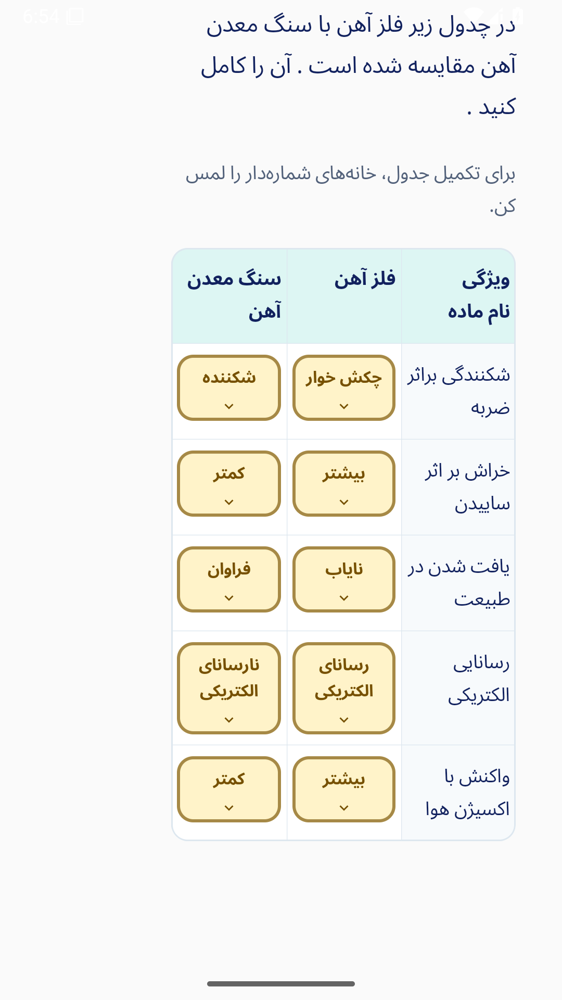

# بازبینی محتوایی و اصلاح نمایش فصل‌های ۱ تا ۵

## موارد اصلاح‌شده

| مورد ارسالی | علت | اصلاح |
| --- | --- | --- |
| دو عنوان «راهنمایی ۱» | راهنمای هر مرحله بدون زمینه در کارت جدا رسم می‌شد | یک عنوان برای هر سطح، همراه با عنوان بخش مربوط به هر راهنما |
| دو کادر سفید زیر جدول ابزارها | کارت مرحله حتی بدون ورودی یا راهنما رسم می‌شد | مرحله‌های تعاملی داخل صورت سؤال می‌مانند؛ کارت خالی رسم نمی‌شود |
| نصفه‌بودن جدول | حداقل عرض ثابت برای هر ستون و پیمایش افقی | تمام ستون‌ها در عرض صفحه؛ تغییر جهت جدول عریض آهن با حفظ همهٔ خانه‌ها؛ متن خانه تمام عرض را دارد و نشان انتخاب زیر آن قرار می‌گیرد |
| روی‌هم‌افتادن جای‌خالی‌ها | ارتفاع جای‌خالی از فاصلهٔ سطر متن بیشتر بود | ارتفاع مستقل هر بند براساس بلندترین انتخاب و فاصلهٔ صریح بین بندها |
| صفحهٔ فصل | سرصفحهٔ بزرگ عمومی بدون تصویر اختصاصی | تصویر کامل و بدون برش فصل، پیشرفت واقعی و شروع/ادامهٔ یادگیری |
| تداخل عنوان با نوار وضعیت | رعایت‌نشدن فضای نوار وضعیت در سرصفحهٔ سفارشی | فاصلهٔ ایمن بالای صفحه در فصل‌های ۱ تا ۵ |

## مقابلهٔ محتوا

هر ۱۰۴ سؤال، ۱۰۴ پاسخ مرجع و انتخاب‌های درست با صفحات ۲ تا ۱۹ کتاب کار ۶۳ صفحه‌ای ۱۴۰۵ و هر ۹ صفحهٔ پاسخ‌نامهٔ مستقل فصل‌های ۱ تا ۵ بررسی شد. کتاب ۴۸ صفحه‌ای پیوست قدیمی، جایگزین منبع نسخهٔ ۱۴۰۵ نشد.

در سؤال ۲ فصل ۵، عنوان ستون صورت سؤال به «واکنش با اکسیژن هوا» برگردانده شد تا دقیقاً با سؤال منبع سازگار باشد. عنوان دارای غلط تایپیِ پاسخنامه و متن سایر پاسخ‌های مؤلف تغییر نکرده‌اند. رسید هر ۱۰۴ مورد و دو نکتهٔ مربوط به عبارت‌بندی خود منبع در [ممیزی محتوا](../qa/first_five_source_recheck_2026_10_20.json) موجود است.

دو نکته از خود منبع نیز ثبت شد: در سؤال ۱ فصل ۲، کلمهٔ «واحد» برای پاسخ «طول» به‌کار رفته، در حالی که طول نام کمیت است؛ در سؤال‌های ۱ و ۹ فصل ۵، ترکیب ساده‌شدهٔ بتن، سنگ‌دانهٔ درشت را ذکر نمی‌کند. طبق تصمیم قبلی مؤلف برای حفظ عین متن و کلید، این عبارت‌ها بازنویسی نشده‌اند.

## معیار آزمون نمایش

هر سؤال با انتخاب‌های کامل و هر پاسخ مرجع، در سه حالت «عرض ۳۲۰ و قلم ۱۰۰٪»، «عرض ۳۶۰ و قلم ۱۵۰٪» و «عرض ۳۲۰ و قلم ۲۰۰٪» رندر می‌شود: ۶۲۴ حالت. آزمون، تقاطع مستطیل جای‌خالی‌ها، خروج کنترل از عرض صورت سؤال، بیرون‌زدن جدول و بریده‌شدن چیدمان متن را بررسی می‌کند. آزمون‌های لمس واقعی جدول، دو مرحلهٔ راهنمای چندبخشی و صفحهٔ فصل نیز برقرارند.

برای متن ساده، اطلاعات معنایی Compose گاهی پاراگراف را با عرض مجازِ بزرگ‌تر از کادر واقعی بازسازی می‌کند. به همین دلیل آزمون، همان متن، قلم و جای‌خالی‌ها را دوباره در کادر واقعی اندازه می‌گیرد؛ هر دو نمونهٔ عمداً بریده از نظر عرض و ارتفاع نیز باید رد شوند. بررسیِ برخورد و خروج جای‌خالی‌ها و جدول‌ها مستقل از این اندازه‌گیری باقی است. [کد اصلی AndroidX برای بازسازی اطلاعات معنایی](https://github.com/androidx/androidx/blob/androidx-main/compose/foundation/foundation/src/commonMain/kotlin/androidx/compose/foundation/text/modifiers/ParagraphLayoutCache.kt).

نتیجهٔ [اجرای واقعی اندروید](https://github.com/nranjbar/oloomyar7/actions/runs/39477236681): هر ۴۱ آزمون واحد، هر ۴۳ آزمون رابط، هر ۶۲۴ حالت نمایش و هر ۳ آزمون نصب روی نسخهٔ ۰٫۶ و بازیابی پس از بستن فرایند موفق شد. [رسید نسخهٔ ۰٫۷](../qa/grade7_v07_verification.json) و [گزارش کامل ۶۲۴ حالت](../qa/native_layout_audit_v07.json) ثبت شده‌اند. دادهٔ فصل‌های ۶ تا ۱۵ و فایل‌های PDF منبع دست‌نخورده‌اند.

## تصاویر واقعی اندروید

تصاویر از شبیه‌ساز API 35 ثبت شده‌اند. نمونه‌های جدول و جای‌خالی، نمای محتوای بومی در آزمون عرض ۳۲۰ هستند؛ تصویر فصل و راهنماها از مسیر واقعی برنامه‌اند.

| صفحهٔ فصل | راهنمای چندبخشی با یک عنوان |
| --- | --- |
|  |  |

| جدول کمیت‌ها | جدول ابزارها |
| --- | --- |
|  |  |

| جای‌خالی‌های سؤال ۲۱ فصل ۳ | مقایسهٔ آهن |
| --- | --- |
|  |  |
