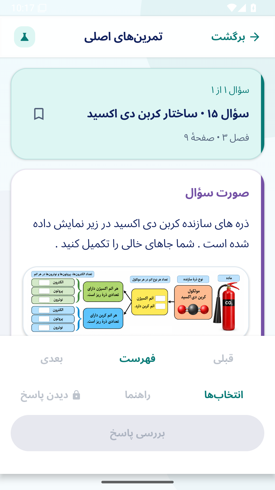
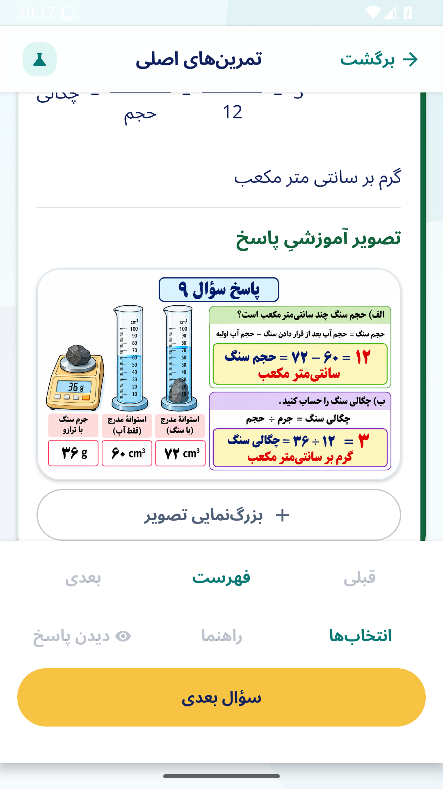
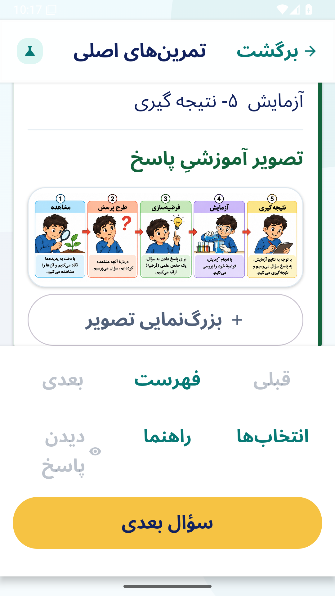
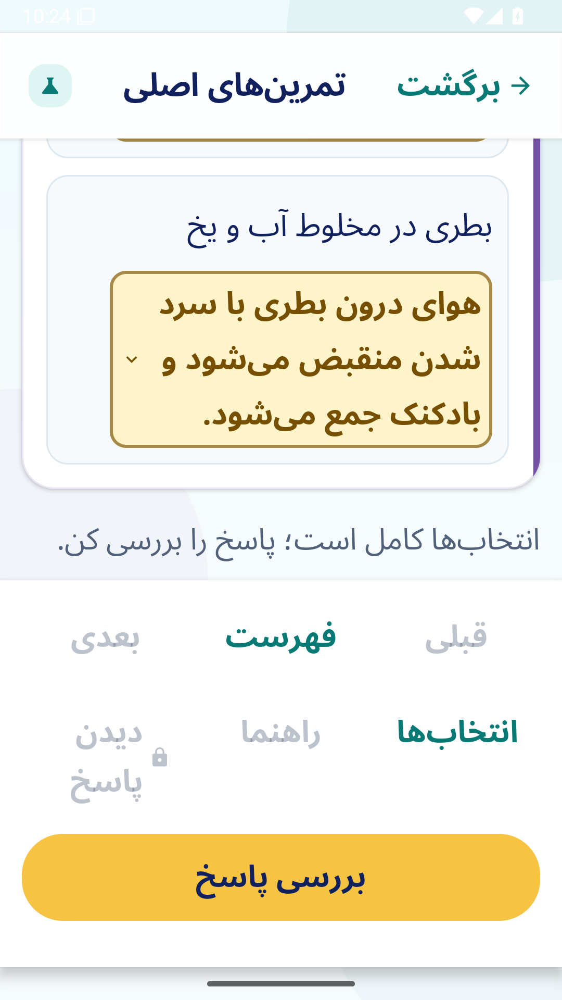
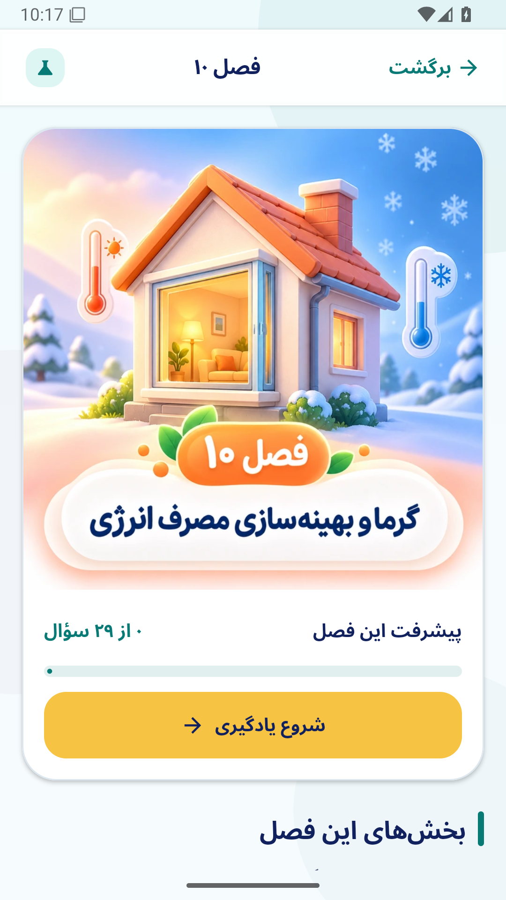
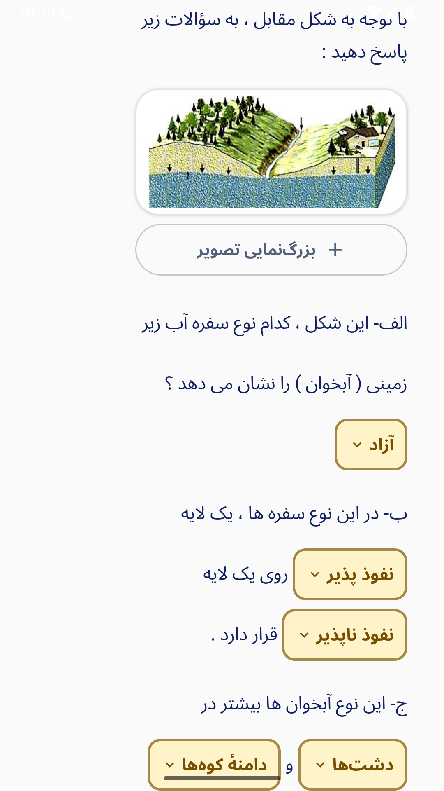
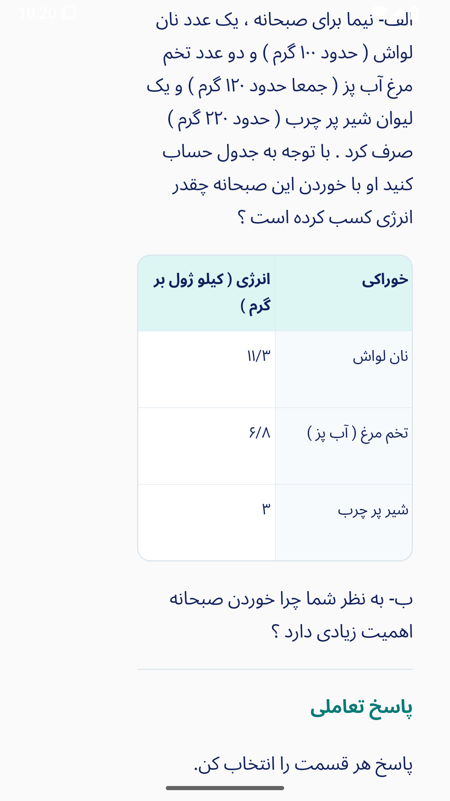
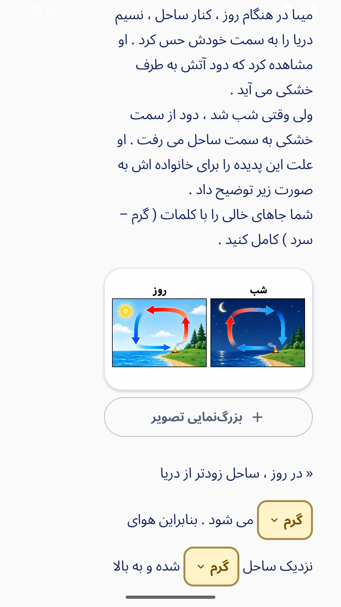
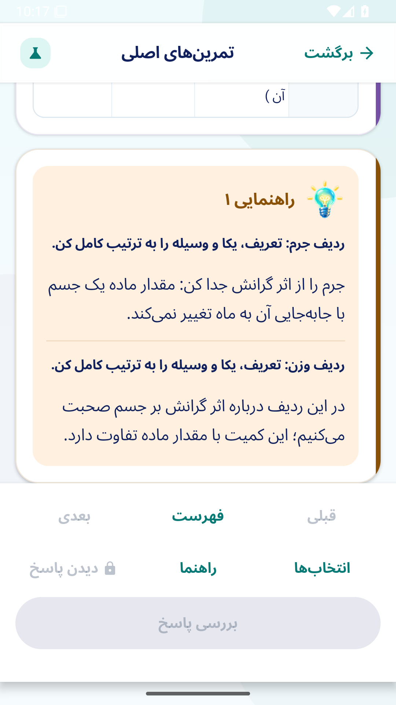
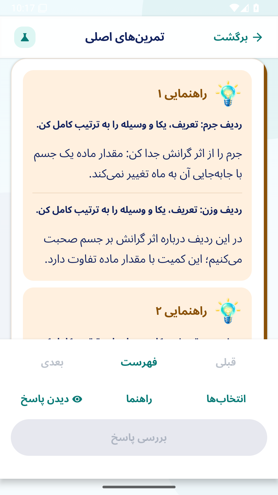

# تکمیل فصل‌های ۱ تا ۱۰ و تصاویر ارسالی — ۲۱ اکتبر ۲۰۲۶

نسخهٔ ۰٫۸ علوم‌یار هفتم شامل ۳۱۷ سؤال است. صورت و پاسخ ۲۳۲ سؤال فصل‌های ۱ تا ۱۰ با متن بومی، ۱۰ جدول کامل، ۲۰ بخش فرمولی و ۳۲۶ جای خالی چاپی نمایش داده می‌شود. ۱۲۸ سؤال فصل‌های ۶ تا ۱۰ در این مرحله تبدیل شده‌اند. متن اصلی سؤال‌ها و پاسخنامه و هر ۱۶ PDF اصلی حفظ شده‌اند.

## درخواست‌های انجام‌شده

- گزینهٔ مبهم «این اتفاق نمی افتد و برعکس است» با دو توضیح مستقلِ هوای گرم/منبسط و هوای سرد/منقبض جایگزین شده است. معیار تمرین از متن مرجع کتاب جداست.
- گزینه‌های همهٔ فهرست‌ها، صحیح/غلط و طبقه‌بندی پس از انتخاب در دسترس می‌مانند و می‌توان آن‌ها را برای خانه‌های دیگر انتخاب کرد. انتخاب یک خانه پاسخ خانهٔ دیگر را حذف نمی‌کند. بخش درست پس از بررسی، مطابق سیاست آموزشی قبلی قفل می‌ماند.
- جدول‌ها بدون پیمایش افقی، سطرهای جای خالی با ارتفاع مناسب و راهنماها با یک عنوان برای هر سطح نمایش داده می‌شوند. صفحهٔ هر فصل تصویر ارسالی، پیشرفت واقعی و ادامهٔ تمرین دارد.
- شکل کامل ارسالیِ سؤال ۱۵ فصل ۳، با همهٔ شاخه‌ها و راهنما، پیش از اولین جای خالی آمده و بزرگ‌نمایی دارد. بخش تعاملی هشت خانهٔ مستقل را حفظ می‌کند.
- ۴۰ شکل سؤالِ مرتبط از بستهٔ ارسالی متصل‌اند؛ ۲۳ شکل جدید فصل‌های ۴ تا ۱۰ با تبدیل بدون اتلاف اضافه شده‌اند. هفت تصویر آموزشی پاسخِ فصل‌های ۱ و ۲ جدا از متن مرجع، فقط پس از باز شدن مجاز پاسخ نمایش داده می‌شوند. هر دو مسیر حل درست و دو تلاش نادرست متفاوت/دو راهنما، همان بخش پاسخ را باز می‌کنند.
- آیکن‌های ارسالی برای درست، نادرست، راهنما، کتاب پاسخ، نشان یادگیری و حالت خالی استفاده شده‌اند. تصویر دفتر پیشرفت نیز روی صفحهٔ پیشرفتِ خالی قرار دارد.
- شناسهٔ منبع برای حالت تصویر و ویرایشگر حفظ می‌شود؛ رفت‌وبرگشت سریع بین شکل‌ها و خروج از صفحه آزموده شده است. تغییر برچسب گزینه‌ها، پیش‌نویس، سابقهٔ تلاش، راهنما و ترتیب تصادفی را به شکل محافظه‌کارانه منتقل می‌کند.

## تصاویر پاسخ پیشنهادی فصل‌های ۳ تا ۱۰

هر ۲۰۴ سؤال بررسی شده است. [فهرست خوانا و جست‌وجوپذیر](../review/Answer_Illustrations_Ch3-10_FA.html)، [جدول CSV](../review/Answer_Illustrations_Ch3-10_FA.csv)، [نسخهٔ متنی](../review/Answer_Illustrations_Ch3-10_FA.md) و [مشخصات ساختاریافته](../review/answer-illustrations-ch3-10.json) ثبت شده‌اند: ۱۱۹ کاربرد تصویری، با ۹۵ فایل متمایز؛ موارد استفادهٔ مشترک مشخص‌اند. برای هر مورد، شمارهٔ سؤال، صفحه، نام PNG/SVG، اولویت، شکل پایه و دستور علمی رسم آمده است.

این‌ها مشخصات ساخت تصاویر بعدی هستند؛ جز مسیر همرفت فصل ۱۰ سؤال ۱۳ که از خود پاسخنامه موجود است، فهرست به معنی ساخته‌شدن این ۹۵ تصویر نیست. تصاویر سؤالِ ارسالی نیز خودبه‌خود نسخهٔ پاسخ‌دار محسوب نمی‌شوند. ۱۳ تصویر بسته که مربوط به فصل‌های بعد از ۱۰ یا سؤالات پایانی‌اند، فعلاً وارد دامنهٔ این اصلاح نشده‌اند.

## مغایرت‌های منبع

| مورد | رفتار برنامه |
|---|---|
| فصل ۷، سؤال ۱۴، قسمت ب | این بخش در کلید چاپی پاسخ جدا ندارد؛ تمرین بر اساس تعریف منطقهٔ اشباع پوشش داده شده و یادداشت دارد. |
| فصل ۸، تست ۳ | واحد انرژی کل در گزینه‌های تمرین کیلوژول است؛ خطای واحدِ متن چاپی با یادداشت مشخص شده است. |
| فصل ۹، سؤال ۱۵ | شکل، ۱ را مولد و ۲ را توربین نشان می‌دهد؛ تمرین با شکل بررسی می‌شود. کلید چاپیِ جابه‌جا تغییر نکرده است. |
| فصل ۱۰، تست ۲ | گزینه‌های تمرین فقط نتیجهٔ قابل مشاهدهٔ نمودار را می‌پرسند و علت اثبات‌نشده به آن اضافه نمی‌کنند. |
| فصل ۱۰، سؤال ۲۱ | رنگ مرئی چای به‌تنهایی سرعت سردشدن را مشخص نمی‌کند. استتارِ پوشش سفید خرس از عایق بودن مو و چربی جداست. تفاوت معیار تمرین با کلید چاپی صریح است. |
| فصل ۱۰، تست ۴ | معیار علمی تمرین «ج» است؛ متن اصلی کلید «الف» جداگانه حفظ شده و یادداشت دارد. |

اصل کلید و متن منبع بازنویسی نشده است. مغایرت قدیمی تست ۳ فصل ۱۳ هم دست‌نخورده و مشخص باقی مانده است. مراجع علمی بررسی: [توربین و مولد](https://www.energy.gov/cmei/water/how-hydropower-works)، [رنگ مرئی و تابش فروسرخ](https://openstax.org/books/college-physics-2e/pages/14-7-radiation)، [پوشش خرس قطبی](https://www.nps.gov/bela/learn/nature/polar-bear.htm). نتیجه دربارهٔ کافی نبودن رنگ چای، استنتاج از تفاوت رنگ مرئی و گسیل فروسرخ و دیگر مسیرهای اتلاف گرماست.

## نتیجهٔ اجرا

[اجرای موفق اندروید](https://github.com/nranjbar/oloomyar7/actions/runs/39582164798) روی تعهد `6aa0e4e3e2882f10cb23a8b03a5ccfac5cdaae87`:

- ساخت APK و AAB، هر ۴۱ آزمون واحد و هر ۵۵ آزمون رابط روی Android API 35 موفق؛ بدون آزمون حذف‌شده یا غیرفعال.
- هر ۱۳۹۲ حالت نمایشِ صورت تکمیل‌شده و کلید مرجعِ ۲۳۲ سؤال موفق: عرض ۳۲۰ و قلم ۱۰۰٪، عرض ۳۶۰ و قلم ۱۵۰٪، عرض ۳۲۰ و قلم ۲۰۰٪. کنترل‌های منفیِ بریدگی واقعی نیز اجرا شده‌اند.
- برابری پیکسل‌های هر ۴۷ شکل علمی ارسالی و هر ۱۷ شکل استخراج‌شده از PDF روی اندروید کنترل شده است. شکل‌های علمی بدون کوچک‌سازی و بدون اتلاف نگه داشته شده‌اند؛ حجم APK حدود ۶۰ مگابایت است.
- هر سه آزمون نصب جایگزین نسخهٔ ۰٫۷ و بازیابی پس از پایان واقعی فرایند موفق؛ پاسخ‌ها، راهنماها، ترتیب گزینه‌ها، پیشرفت، نشان‌ها و تنظیمات حفظ شدند.

[رسید اجرا](../qa/grade7_v08_verification.json)، [گزارش کامل حالت‌های نمایش](../qa/native_layout_audit_v08.json)، [تطبیق سؤال‌به‌سؤال منبع](../qa/first_ten_source_recheck_2026_10_21.json) و [ثبت منشأ و پیکسل تصاویر ارسالی](../qa/source/owner-art-2026-10-21.json) موجودند. این نتایج از XMLهای اجراشده و گزارش دستگاه‌اند و دامنهٔ دستگاه/اندازه‌های آزموده‌شده را نشان می‌دهند.

## تصاویر واقعی دستگاه

## باقی‌ماندهٔ پروژه

تبدیل کامل نمایش فصل‌های ۱۱ تا ۱۵، شامل ۸۵ سؤال، باقی است. سؤالات پایانی صفحات ۶۰ تا ۶۳ جدا از ۳۱۷ سؤال فصل‌ها هستند.
